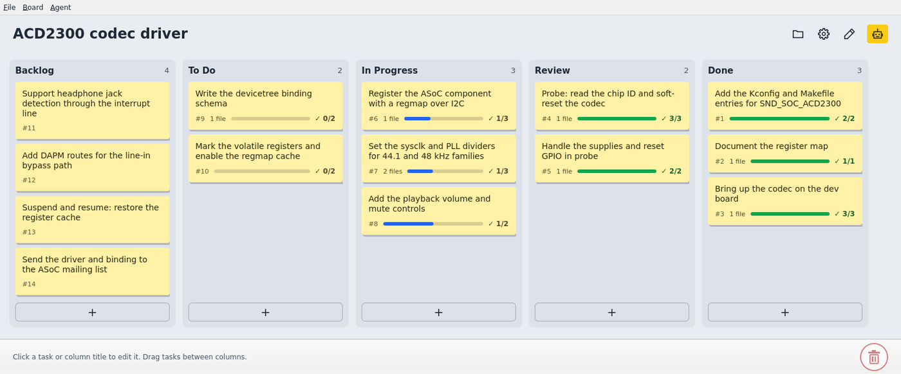

# agent-stickynotes

A local, Trello-style kanban board for humans and AI agents. One Rust binary with
a QML UI; while it runs it also serves an MCP server and a REST API on loopback,
so Claude Code (or any agent) can read the board, add tasks, tick criteria, and
attach Markdown and images to tasks.



- **Columns are a pipeline.** Each column's description says what a task must
  satisfy to be there. Agents create tasks in the first column and advance them one
  column at a time; you can drag anything anywhere.
- **Agents are visible.** Notes an agent changed glow until you are back. Agent
  write access is **off** by default (the robot icon in the toolbar toggles it).
- **Artifacts.** Agents attach specs, notes and diagrams to tasks. They open in a
  viewer window with contents, search and zoom, and the folder icon in the toolbar
  lists every file in the project.
- **Plain files.** A board is a project folder: `stickynotes.json` plus `artifacts/`.

The board above is [`examples/i2c-codec`](examples/i2c-codec): open it with
`cargo run --release -- examples/i2c-codec` (work on a copy; changes are saved).

## Install

Needs Rust 1.93+ and the Qt 6 development packages (Debian/Ubuntu):

```sh
sudo apt install qt6-base-dev qt6-base-dev-tools qt6-declarative-dev \
  qml6-module-qtquick-dialogs qml6-module-qtquick-controls \
  qml6-module-qtquick-layouts qml6-module-qtquick-window qml6-module-qtqml-models
export QMAKE=/usr/lib/qt6/bin/qmake6     # if `qmake` is Qt 5

cargo install --locked --git https://github.com/Nitepone/agent-stickynotes stickynotes
# or from a clone, adding the application-menu entry and icon (Linux):
scripts/install-linux.sh                 # --uninstall removes it again
```

Prebuilt AppImage, Windows and macOS builds are attached to each
[release](https://github.com/Nitepone/agent-stickynotes/releases).

## Run

```sh
stickynotes [project-folder]
```

A new or empty folder becomes a project. Without an argument the last project is
reopened, and on first run a picker opens. Projects live by default in your user
data folder (`~/.local/share/agent-stickynotes/projects` on Linux,
`~/Library/Application Support/agent-stickynotes/projects` on macOS,
`%APPDATA%\agent-stickynotes\data\projects` on Windows); **Browse…** opens a
folder anywhere else.

## Connect an agent

Open **Agent ▸ Connect Claude Code…**, copy the command, and run it once. See
[docs/claude-code-setup.md](docs/claude-code-setup.md) for the tools, the REST API
and the artifact rules.

## More

- [Using the app](docs/usage.md): editing, references, drafting, spell check, themes
- [Development](docs/development.md) and [AGENTS.md](AGENTS.md) for contributors; [PLAN.md](PLAN.md) for the design
- [Building release packages](docs/packaging.md)

MIT licensed.
